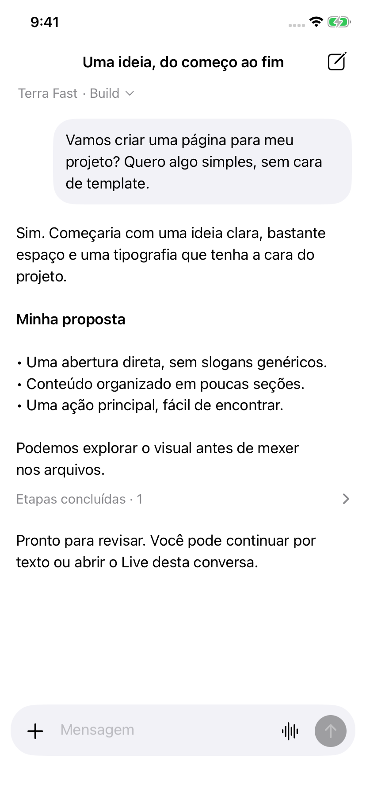
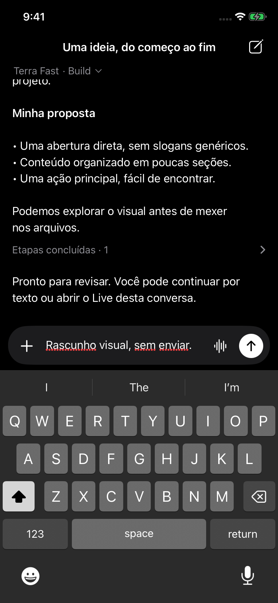
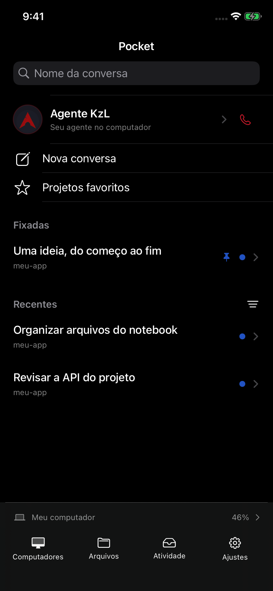
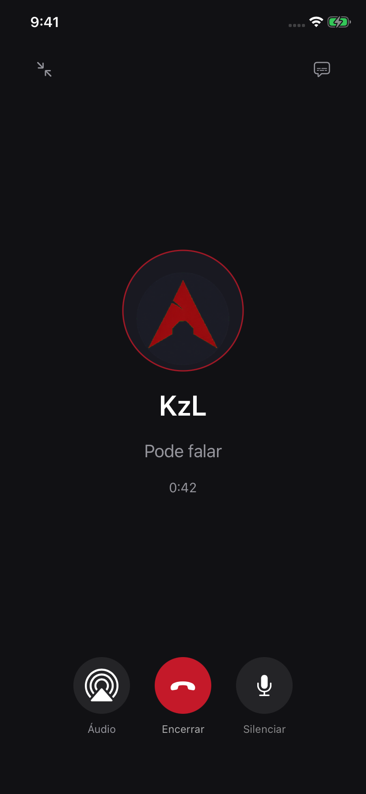

# Pocket 0.16.0 — conversation-first design

## Visual system

Native SF Pro for interface and conversation; SF Mono only for code/tool data.
Adaptive system background/label colors keep reading contrast in light and dark
mode. The KzL call uses graphite (`#111114`) and restrained red (`#C41A29`).
Secondary labels use system gray (`#8E8E93` equivalent); neutral composer surfaces
use the adaptive secondary background (`#F2F2F7` in light mode). Red is KzL's
identity, not a generic failure signal. Existing unread blue and running green
indicators remain distinct and carry accessibility text.

## Navigation

The real history sidebar replaces the long global overflow popup. KzL is first,
with its original avatar and a dedicated phone action. New conversation, search
and favorite projects sit above pinned/recent chats. Filtering moves to a small
three-choice menu in the recent heading. A fixed footer provides Computers,
Files, Activity and Settings; a compact computer row opens battery/storage/quota
instead of keeping a dashboard above chats.

The last conversation pointer is stored per server and restored from protected
cache or the server. Missing history is not silently replaced with another chat.
New conversation uses Core defaults in one tap; favorite projects still provide
an explicit location workflow. Existing generation checks protect host switching.

## Conversation

Assistant responses are open text without repeated author headers; user messages
keep a neutral bubble. Tools summarize working/completed/error states in one
expandable row. File metadata has a compact card, not a fake download action.
Actual generated-file transfer support remains a separate implementation.

The composer is a single rounded row with attachments, expanding text (five-line
limit), contextual Live/KzL call and send. Technical connection status appears
only when loading, cached or offline. Real draft/send errors remain visible.
Permission requests have a compact review banner leading to their full context;
approval and strict detail requirements are unchanged. No permission is auto-granted.

## KzL call

One charcoal full-screen call replaces the old blue preparation sheet. The
original user-provided PNG is embedded unchanged (SHA-256
`b590bf8c441df43e9b9a314b8220c6e3050e451369ede0a4189a7fecffe677ef`).
Controls are minimize, optional captions, audio route, end and mute. A task card
appears only when actual task records exist. Technical diagnostics stay in the
Live/settings surfaces instead of the main call screen.

Tapping the phone prepares an explicit call request. First use shows paid-API
and privacy disclosure; acceptance is remembered and later phone taps initiate
calls directly. Voice settings can reset this disclosure. Simulator previews
never start a real paid call. In-flight initiation is guarded across minimizing
and host changes; the existing call time limit remains in effect.

## Evidence and limits

The UI preview workflow now targets an iPhone 11 simulator when available,
captures conversation/sidebar/call/Live/permission states, and exercises history
on open, keyboard with unsent draft, one-tap new conversation and cancellation of
the billing disclosure. It uses only synthetic data and does not touch the
physical iPhone or register an Apple signing account.

Screenshots and accessibility assertions demonstrate those fixture states, not
end-to-end live server synchronization or physical microphone/background audio.
CallKit, lock-screen audio and the user's historical keyboard bug still require
physical acceptance. The redesign does not claim parity with the ChatGPT app.

### Verified delivery

- [Final IPA build and regression tests](https://github.com/Omokir/opencode-iphone/actions/runs/41034366896): passed; 112 gateway tests plus catalog and native regression suites.
- [Full iPhone 11 UI interactions](https://github.com/Omokir/opencode-iphone/actions/runs/41032220252): passed history on open, keyboard with unsent draft, new chat without directory prompt, billing cancellation and synthetic active-call controls.
- [Final call contrast preview](https://github.com/Omokir/opencode-iphone/actions/runs/41034375644): passed and visually reviewed.
- Unsigned IPA: `OpenCode-Pocket-0.16.0.ipa`, version 0.16.0, build 29. SHA-256: `e87b8554474dd292be567bd832817766faa971ac2fad97b836c48cbaa70570f4`.
- No physical installation or paid call performed for this delivery.

### Reviewed simulator previews

Synthetic content; call screenshot is layout-only, not evidence of working audio.

| Conversation | Keyboard and unsent draft |
| --- | --- |
|  |  |

| History sidebar | KzL call controls |
| --- | --- |
|  |  |
